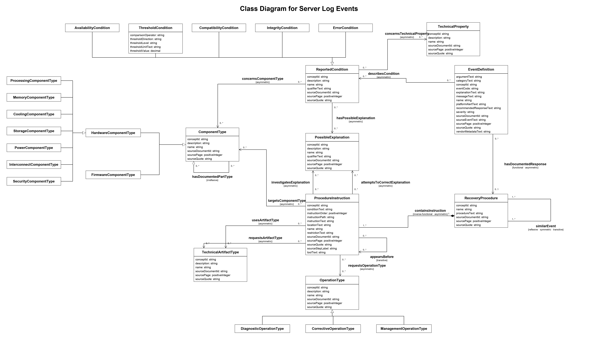

# Server Troubleshooting Knowledge Graph

An ontology and knowledge graph for organising documented server error events and their recommended troubleshooting responses. This repository contains the **first phase** of the research: a Dell PowerEdge catalogue dataset, its ontology, a populated RDF graph, and validation results.

## Problem and motivation

When a server reports a hardware or firmware problem, an engineer may need to read several parts of a troubleshooting guide to connect the message with its meaning and the recommended response. Event codes help locate an entry, but the condition, possible explanation, affected component, and instructions may be described in different parts of that entry. This project represents those connections explicitly so they can be inspected and queried.

The current graph organises *documented event definitions*. It does not contain observed server incidents, actual log files, or verified repair outcomes.

## Research objectives

1. Identify troubleshooting concepts and relationships from the source guide and represent them in an OWL ontology.
2. Populate an RDF knowledge graph while retaining the original message, complete recommended response, and source-page references.
3. Check ontology quality and consistency, validate graph structure, and query the resulting knowledge.

## Source and dataset

The source is Dell Technologies' [*PowerEdge Servers Error and Event Messages Reference Guide*](https://dl.dell.com/content/manual64973867-poweredge-servers-error-and-event-messages-reference-guide.pdf?language=en-us), July 2026, Rev. A00. [`Dataset/events.json`](Dataset/events.json) contains **6,152** selected definitions: **2,476 Critical** and **3,676 Warning**. Informational entries were excluded; no additional hardware-only keyword filter was applied.

Each record retains its event code, severity, category, message, arguments, explanation, recommended response, source pages, and extracted source text. A `knowledge` section holds source-grounded candidates for components, properties, possible explanations, and response items. These candidates are not all expert-validated assertions. The [dataset guide](Dataset/README.md) describes the fields and their interpretation.

## Method

```text
Dell reference guide
        ↓
Event extraction and text processing
        ↓
Concept and relationship modelling
        ↓
OWL ontology → RDF knowledge graph
        ↓
OQuaRE · HermiT · SHACL · SPARQL queries
```

The ontology defines nine main concepts, including `EventDefinition`, `ReportedCondition`, `ComponentType`, `PossibleExplanation`, `RecoveryProcedure`, and `ProcedureInstruction`. Its relationships connect an event to the condition it describes and to its documented response; a procedure connects to instructions in source order. Reusable concepts describe component kinds, technical properties, operation kinds, and technical artifact kinds. Selected classes are aligned to terms from NORIA-O, SAREF, and DUL. These alignments use external class identifiers; the external ontologies are not imported into the file.

The knowledge graph contains one `EventDefinition` for each selected catalogue entry. Relationship evidence is recorded where the builder asserts a source-supported mapping. The full Dell response text remains available even when individual instructions or their diagnostic purpose need further review.



## Repository contents

| Folder | Contents |
| --- | --- |
| [`Dataset/`](Dataset/) | `events.json` and the dataset field guide. |
| [`Diagram/`](Diagram/) | UML diagram image and interactive HTML diagram. |
| [`Extraction/`](Extraction/) | Knowledge-extraction script and supporting document. |
| [`Ontology/`](Ontology/) | OWL ontology in Turtle and RDF/XML, plus its Python builder. |
| [`Knowledge Graph/`](Knowledge%20Graph/) | Populated graph in Turtle and RDF/XML, SHACL shapes, and graph builder. |
| [`Evaluation/`](Evaluation/) | Saved OQuaRE, HermiT, RDF statistics, and SHACL results; 12 SPARQL competency questions and a runner. |

`.ttl` is the human-readable Turtle serialization; `.owl` is the RDF/XML serialization of the same model or graph.

## Query the included graph

Install [RDFLib](https://rdflib.readthedocs.io/) and run this example from the repository root. It retrieves Dell's documented response for `BAT0009` from the included graph:

```bash
python3 -m pip install rdflib
python3 - <<'PY'
from rdflib import Graph

graph = Graph().parse("Knowledge Graph/knowledge_graph.ttl", format="turtle")
query = """
PREFIX dell: <https://example.org/dell-troubleshooting#>
SELECT ?response WHERE {
  ?event a dell:EventDefinition ;
         dell:eventCode ?code ;
         dell:hasDocumentedResponse ?procedure .
  FILTER(STR(?code) = "BAT0009")
  ?procedure dell:procedureText ?response .
}
"""
for row in graph.query(query):
    print(row.response)
PY
```

The event code supplies an exact starting point. Matching an arbitrary new log message to the correct event is a separate retrieval task and has not been evaluated in this phase.

## Competency questions

The [`Evaluation/competency questions/`](Evaluation/competency%20questions/) folder contains 12 `.rq` files that inspect coverage, graph relationships, response structure, and missing structured information. Run them against the complete included graph from the repository root:

```bash
python3 "Evaluation/competency questions/run_cq.py" --number 5
python3 "Evaluation/competency questions/run_cq.py" --all --limit 3
```

The runner uses RDFLib and prints the total result-row count and the first displayed rows. A result with no rows can be a meaningful negative-boundary result; interpret each question in context. CQ11 identifies nonconsecutive source positions among retained instructions, which may reflect excluded context text rather than an invalid procedure.

## Saved evaluation results

| Check | Recorded result | What it checks |
| --- | --- | --- |
| [OQuaRE](Evaluation/oquare/oquare_results.json) | **3.91 / 5** overall | Structural quality characteristics of the ontology schema. |
| [HermiT](Evaluation/hermit/hermit_results.json) | Consistent; **0** unsatisfiable named classes | Logical consistency of the ontology schema. |
| [RDF statistics](Evaluation/SHACL/rdf_statistics.json) | **339,850** triples; **6,152** event definitions; **10,133** procedure instructions | Size and population of the graph. |
| [SHACL](Evaluation/SHACL/shacl_validation_results.json) | Conforms; **0** validation results | Conformance of the populated graph to the included shapes. |

These results measure schema quality, logical consistency, and declared data constraints. They do not measure diagnostic accuracy or the success of a repair. SPARQL can retrieve connected knowledge from the graph; comparative retrieval experiments are outside this release.

## Current scope and limitations

- The dataset covers one Dell guide and has not yet been tested for cross-vendor interoperability.
- Possible explanations and detailed instruction-to-explanation links have limited coverage. An absent link must not be read as proof that no explanation exists in the guide.
- BM25, semantic retrieval, hybrid ranking, and LLM-based diagnosis have **not** been compared in this phase.
- The included builder scripts were copied from the research workspace. Some still refer to the earlier `dell_test` directory layout or a source PDF outside this repository; update those paths before attempting a full rebuild. The prebuilt ontology and graph can be read and queried directly.

## Source and standards

- Dell Technologies, [*PowerEdge Servers Error and Event Messages Reference Guide*](https://dl.dell.com/content/manual64973867-poweredge-servers-error-and-event-messages-reference-guide.pdf?language=en-us).
- W3C, [OWL 2 overview](https://www.w3.org/TR/owl2-overview/), [SHACL](https://www.w3.org/TR/shacl/), and [SPARQL 1.1 Query Language](https://www.w3.org/TR/sparql11-query/).
